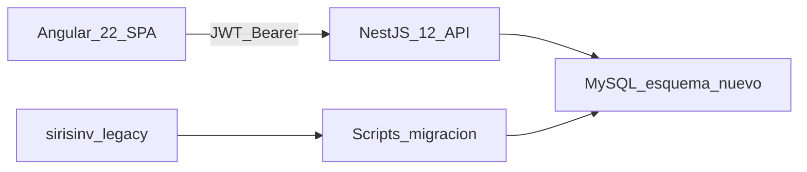
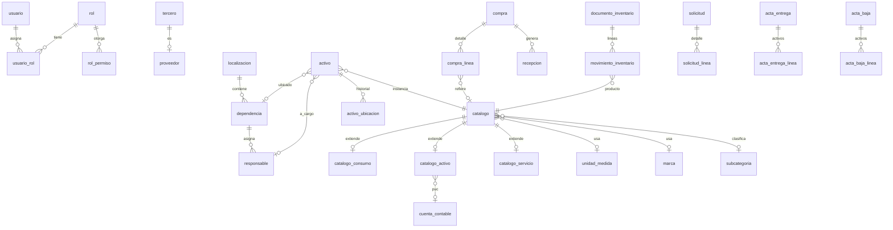
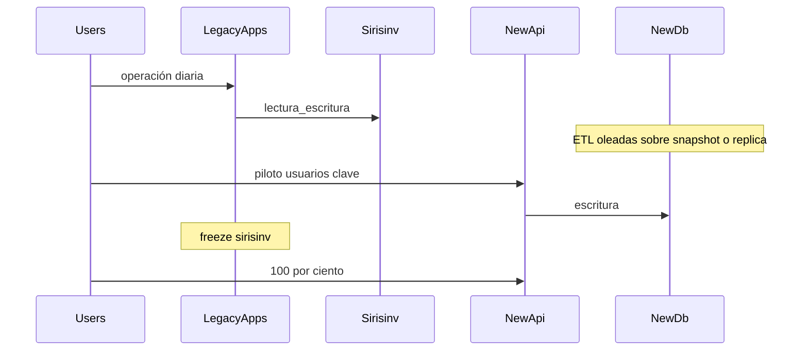

# Referencia de migración: inventario unificado (Activos + Consumo)

Documento de especificación para **construir un aplicativo nuevo** que unifique las aplicaciones actuales **Activos** y **Consumo**. No es una guía de lift-and-shift: el producto se reescribe sobre un esquema de base de datos nuevo, con migración de datos desde `sirisinv`.

| Campo | Valor |
| --- | --- |
| Fecha de referencia | 2026-09-07 |
| Base de datos origen | MySQL 8, esquema `sirisinv` (dump en [Estructura_BD.md](Estructura_BD.md)) |
| API objetivo | NestJS **12.x** (estable: 12.0.x; Node.js ≥ 20.19 o ≥ 22.12) |
| Frontend objetivo | Angular **22.1.x** + **Tailwind CSS** (UI responsiva, modos **Light** y **Dark**) |
| ORM | TypeORM 0.3.x, `synchronize: false`, migraciones explícitas |
| Entregable de esta fase | Este documento. No incluye código del aplicativo nuevo. |

---

## 1. Contexto y objetivo

Mallamas opera hoy **dos frontends y dos APIs** contra la **misma** base `sirisinv`:

- **Activos:** gestión de activos fijos (placas, ubicación, actas, depreciación, compras/recepciones/facturas, PUC/Siigo).
- **Consumo:** inventario de consumo (productos, kardex, documentos firmables, órdenes de compra, solicitudes).

El producto unificado debe ofrecer **un login, un menú, una API NestJS y una base nueva**, cubriendo ambos dominios y los maestros compartidos (usuarios, terceros, organización, compras).

**Estrategia:** reescritura. El API NestJS 9 de Consumo se usa como **referencia de patrones** (módulos, DTO, Swagger, Excel/PDF), no como código a copiar. El backend Express de Activos y el Angular 6 no se actualizan in-place.

### 1.1 Fuera de alcance (decisión cerrada)

No forman parte del aplicativo nuevo: **pedidos, caja/POS, vendedores, zonas ni tipos de precio**. Existen en `sirisinv` y en el frontend de Activos; el backend de Activos **no** los implementa. No habrá pantallas, endpoints, tablas nuevas ni ETL para ese dominio. No es backlog de una v2: es exclusión permanente de este producto.

Detalle de tablas y pantallas: [sección 9.1](#91-tablas-y-pantallas-no-migrar).

### 1.2 Principios

- Conservar continuidad operativa: compras, terceros, responsables, dependencias, localizaciones, usuarios, activos, consumo, solicitudes, actas.
- Unificar catálogos duplicados (`items` vs `products`, dos unidades de medida, dos modelos de movimiento, dos formas de detalle de compra).
- Autenticación JWT por header `Authorization: Bearer`. Roles persistidos y exigidos en API y rutas Angular.
- Secretos y conexión a BD solo por variables de entorno (hoy Activos tiene credenciales en código).
- Consecutivos de documentos en **servicio de aplicación + tabla de series**, no en triggers MySQL opacos.
- Interfaz con **Tailwind CSS**, usable en móvil/tablet/escritorio, con **modo Light y Dark**.

---

## 2. Inventario del estado actual

### 2.1 Comparativa de stacks

| Aspecto | Activos | Consumo | Objetivo unificado |
| --- | --- | --- | --- |
| Frontend | Angular 6 + Material Dashboard Pro + NgRx + Bootstrap 4 | Angular 17 + Material 16 + template Modernize | Angular 22, standalone + signals, **Tailwind CSS** (sin Bootstrap ni plantillas Material Dashboard / Modernize) |
| UI / CSS | Bootstrap 4 + Material | Angular Material 16 + SCSS del template | Tailwind (utility-first); **responsive** mobile-first; **tema Light y Dark** |
| Temas | Claro (fijo) | Claro (fijo) | Light / Dark con persistencia y selector en el layout |
| Routing UI | Hash (`/#/`) | Hash | Hash o Path; una sola app |
| API | Express 4 + TypeScript | NestJS 9 | NestJS 12, prefijo `/api`, Swagger |
| ORM | Sequelize 5 + sequelize-typescript | TypeORM 0.3, `synchronize: true` | TypeORM, `synchronize: false` |
| Auth | JWT query `?token=`, seed en código, 12 h | JWT Bearer (parcial), 120 d en dev; `User` **sin** campo roles | JWT Bearer global, roles en BD, expiración configurable |
| Puerto | 5500 | 8000 | Definir en env (p. ej. 3000) |
| Menú | Dinámico: `menus` / `submenus` / `submenus_roles` + vistas `v_usersmenus` | Estático en `sidebar-data.ts` | BD + guards de ruta |
| Tiempo real | Socket.IO (uso parcial) | No | No requerido en v1 salvo que se justifique |
| Email | Mailjet | No | Conservar si actas/reportes lo necesitan |
| Integración contable | Siigo (`interfaz_siigo`) | No | Incluir en v1 (hoy es flujo de Activos) |
| Importación Excel | Limitada | Módulo `files` | Conservar patrón Consumo |
| PDF | pdfmake en cliente | pdfkit-table en API | Generación en API |
| Offline | No | IndexedDB (borradores compra/solicitud) | Evaluar; no bloqueante de v1 |
| Firma | No | Signature pad + blob en `inventory_documents` | Conservar para documentos de consumo |

### 2.2 Huecos de seguridad a no repetir

- Activos: token en query string; credenciales MySQL, Mailjet y Google Maps en código; sin RBAC por endpoint.
- Consumo: muchos controllers **sin** `@Auth()`; `UserRoleGuard` existe pero `users` no tiene roles; guards Angular definidos y **no** aplicados a rutas; `synchronize: true`.
- Unificado: `APP_GUARD` JWT global; whitelist de rutas públicas (`/api/auth/login`); roles en `users_roles`; `canActivate` en todas las rutas de negocio; secretos en `.env`; TypeORM sin sync automático.

### 2.3 Dominios funcionales

#### Compartidos (ambas apps + mismas tablas)

| Dominio | Activos (UI / API) | Consumo (UI / API) | Tablas origen |
| --- | --- | --- | --- |
| Usuarios | `/pages/users`, `/users`, `/login` | `/auth/side-login`, `/api/auth` | `users` |
| Roles / menú | `/roles`, `/users_roles`; menú por vistas | `ValidRoles` en código, no persistido | `roles`, `users_roles`, `menus`, `submenus`, `submenus_roles` |
| Terceros / proveedores | `/pages/terceros`, `/terceros`, `/proveedores` | `/api/terceros`, `/api/proveedores` | `terceros`, `proveedores`, tipos documento/persona/régimen, `actividad_economica`, `retefuente` |
| Geografía | `/paises`, `/departamentos`, `/municipios` | Igual | `paises`, `departamentos`, `municipios` |
| Organización | `/pages/localizacion`, `/pages/responsables` | `/responsable/`, `/job-title/`; API dependencias/localizaciones | `localizacion`, `dependencias`, `responsables`, `jobs_title` |
| Compras | Órdenes + detalle `items` + recepciones + facturas | Órdenes + detalle `products`/`services` + `receive` | `compras` (`order_type` A/P/S), `compras_detalle`, `compras_detalle_products`, `compras_detalle_services` |

La tabla `compras` ya es compartida; el **detalle** está partido: Activos usa `compras_detalle.item_id`; Consumo usa UUID en `compras_detalle_products` y `compras_detalle_services`.

#### Solo Activos

| Capacidad | UI | API (prefijo) | Tablas |
| --- | --- | --- | --- |
| Activos fijos / placas | `/activos/*` | `/activos` | `activos`, `items` (tipo A) |
| Ubicación histórica | `/activos/localizar` | `/activo_localiza`, `/v_activos_localiza` | `activo_localiza` (también trigger en `activos`) |
| Actas entrega / baja | `/pages/actas/*` | `/actasentregafuncionario`, `/actasbajas`, detalles | `actas_entrega_funcionario`, `actas_bajas`, `detalle_*` |
| Depreciación / medición / reconocimiento | `/pages/reconocimientos`, `/pages/mediciones`, reportes | `/reconocimiento`, `/mediciones`, `/activos/activos_deprecia` | `reconocimiento`, `mediciones` |
| Catálogo ítems (A/C) | `/pages/items` | `/items`, `/vitem` | `items`, `marcas`, `categorias`, `subcategorias` |
| Movimientos inventario (ajuste) | `/pages/movimientosinventario` | `/movimientos_inventario`, `/movinventariodetalle` | `movimientos_inventario`, `movinventario_detalle`, `tipos_ajuste` |
| Recepciones / facturas compra | `/pages/recepciones`, `/pages/facturascompra` | `/recepciones`, `/facturascompra`, vistas `v_*` | `recepciones`, `recepciones_detalle`, `factura_compra`, `factura_recepcion` |
| PUC / documentos contables / Siigo | `/pages/catalogos`, `/pages/documentoscontables` | `/catalogocontable`, `/documentos_contables`, `/interfazsiigo` | `catalogo_contable`, `documentos_contables`, `interfaz_siigo` |
| Devoluciones / notas / retenciones | Varias `/pages/*` | retefuente/reteiva, conceptos | `devol_compras`, `notasprv`, `pagos_prv`, `reteiva`, `conceptos_*` |
| Uploads / plantillas / mail | config, impresión | `/upload`, `/img`, `/plantillas`, `/mail` | `config`, `plantillas`, filesystem `uploads/` |

#### Solo Consumo

| Capacidad | UI | API | Tablas |
| --- | --- | --- | --- |
| Productos consumo + UM + kardex | `/product/`, `/product/kardex/:id` | `/api/products`, `/api/unit-measure` | `products`, `units_measure` |
| Tipos de movimiento I/O | `/type-movement/` | `/api/type-movement` | `type_movement` |
| Documentos inventario + firma | `/document/`, `/movement/` | `/api/inventory-documents`, `/api/inventory-movements` | `inventory_documents`, `inventory_movements` |
| Solicitudes y aprobación | `/solicitud/*` | `/api/solicitudes` | `solicitudes`, `solicitudes_detalle_products` |
| Servicios de compra | `/service-item/` | `/api/service-item` | `services_item` |
| Import Excel | Desde listados | `/api/files/import-*` | — |
| PDF servidor | Visor cliente | `/api/reports/*` | — |
| IndexedDB | Borradores | — | Cliente |

### 2.4 Solapamientos y conflictos de modelo

| Concepto | Activos | Consumo | Conflicto | Resolución propuesta |
| --- | --- | --- | --- | --- |
| Catálogo de bienes | `items` (`tipo_item` A/C), PK int | `products` UUID, solo consumo | Dos catálogos de consumo | Un `catalogo` + extensiones (ver §5) |
| Unidad de medida | `unidad_medida` (casi no usada en API Activos) | `units_measure` | Duplicado | Una tabla `unidad_medida` |
| Movimiento stock | `movimientos_inventario` + `tipos_ajuste` | `inventory_documents` + `inventory_movements` + `type_movement` | Semántica distinta (ajuste vs documento firmable) | Un documento de movimiento de **consumo**; ajustes de Activos sobre ítems tipo activo no mezclan kardex de fracción |
| Compra | Detalle por `item_id` + recepción/factura | Detalle por product/service + `POST /receive/:id` | Misma cabecera, líneas incompatibles | Líneas polimórficas `compra_linea` |
| ID | Enteros autoincrement | UUID v4 en tablas nuevas Consumo | ETL debe mapear ambos | PK int en esquema nuevo + `legacy_id` / `legacy_source` |
| Auth | `?token=` | `Authorization: Bearer` + localStorage distinto | Dos contratos | Solo Bearer; invalidar tokens viejos en corte |

---

## 3. Arquitectura objetivo



### 3.1 Monorepo sugerido

```
inventario-unificado/
  apps/
    api/          # NestJS 12
    web/          # Angular 22
  packages/
    shared-types/ # DTOs/enums compartidos (opcional)
  docs/
  .env.example
```

Herramienta: Nx o workspaces npm/pnpm. API y web se despliegan por separado (SPA estática + API Node).

### 3.2 API NestJS 12

- Prefijo global `/api`. Documentación Swagger en `/api/docs`.
- Módulos por bounded context (lista en §4).
- Validación: `class-validator` / `class-transformer` (o Standard Schema de Nest 12 si el equipo lo adopta; no mezclar dos estilos en el mismo módulo).
- Auth: Passport JWT, `Authorization: Bearer`, guard global. Decorador de roles (`admin`, `inventario`, `compras`, `activos`, `consulta`, etc. — definir catálogo al implementar menú).
- CORS restringido al origen del SPA.
- Uploads: disco o object storage; rutas autenticadas.
- `TypeOrmModule.forRoot`: MySQL 8, timezone `America/Bogota`, **sin** `synchronize`.
- Node 22 LTS recomendado.

Patrones a **reutilizar** de Consumo: paginación, `find-by-term`, `export` / `export-template`, import Excel, PDF base64, DTOs.

Patrones a **abandonar** de Activos: token en query, Sequelize, routers CRUD copiados a mano sin DTO.

### 3.3 Frontend Angular 22

- Standalone components, `inject()`, signals para estado de sesión.
- **CSS:** Tailwind CSS (última estable al scaffold, p. ej. v4) como framework de estilos. No usar Bootstrap ni los templates Creative Tim / Modernize. No mezclar Angular Material como sistema visual paralelo (CDK solo si hace falta overlay/a11y).
- **Responsive:** diseño mobile-first. Breakpoints Tailwind (`sm`, `md`, `lg`, `xl`, `2xl`). En viewport estrecho: sidebar colapsable/drawer, tablas con scroll horizontal o cards, formularios a una columna, acciones principales alcanzables en táctil.
- **Temas Light y Dark:** estrategia de clase `dark` en `<html>` (selector `darkMode: 'class'`). Tokens de color semánticos (`bg-background`, `text-foreground`, superficies, bordes) para que componentes y PDF-viewer/modales respeten el tema. Toggle en el header; persistir en `localStorage`; primera visita puede seguir `prefers-color-scheme`. El tema es preferencia de UI, no un campo de negocio en BD.
- Un layout (sidebar + header + área de contenido). Menú filtrado por permisos del usuario (payload JWT + endpoint `/api/auth/me`).
- Interceptor HTTP: Bearer; 401 → logout.
- Guards en **todas** las rutas de negocio.
- Locale `es-CO`.
- Reportes: visor PDF de respuestas API; Excel descargado desde API.
- Firma digital: conservar flujo de Consumo en documentos de inventario.
- No incluir layouts `pedidos` ni `caja` de Activos.

### 3.4 Autenticación unificada

1. `POST /api/auth/login` `{ email, password }` → JWT + usuario + menú/permisos.
2. `GET /api/auth/me` y `POST /api/auth/refresh` (o expiración larga + re-login).
3. Contraseñas con bcrypt; no reutilizar el seed JWT de Activos.
4. Migrar hashes de `users.password` si el algoritmo es compatible (bcrypt); si no, forzar reset en el corte.
5. Campo `google` legacy: no implementar OAuth en v1 salvo requisito explícito.

---

## 4. Mapa de módulos del sistema unificado

Cada contexto es un módulo Nest y un área de rutas Angular. El menú lateral propuesto:

- Inventarios: productos (consumo), tipos de movimiento, documentos/kardex, activos, localización, placas.
- Compras: órdenes, recepción.
- Solicitudes.
- Actas: entrega a funcionario, baja.
- Contabilidad: PUC, documentos/series, interfaz Siigo (v1 por existir hoy en Activos).
- Mantenimiento: UM, marcas, categorías, terceros, proveedores, responsables, cargos, sedes/dependencias, usuarios/roles.
- Reportes: depreciación, activos por dependencia/responsable, general, PDFs de documentos.
- Ayuda: manual.

**Sin** entradas de pedidos, caja, vendedores, zonas o tipos de precio.

### 4.1 Identidad y acceso

| Origen UI | Origen API | Tablas origen | Destino |
| --- | --- | --- | --- |
| Activos `/auth/*`, `/pages/users`; Consumo `/auth/side-login` | Activos `/login`, `/users`, `/roles`; Consumo `/api/auth` | `users`, `roles`, `users_roles`, `menus`, `submenus`, `submenus_roles` | `apps/api` Auth + Users + Menus |

### 4.2 Organización

| Origen UI | Origen API | Tablas origen |
| --- | --- | --- |
| Activos `/pages/localizacion`, `/pages/responsables`; Consumo `/responsable/`, `/job-title/` | `/localizacion`, `/dependencias`, `/responsables`, `/job-title`; Consumo equivalentes | `localizacion`, `dependencias`, `responsables`, `jobs_title` |

### 4.3 Maestros tributarios

| Origen UI | Origen API | Tablas origen |
| --- | --- | --- |
| Activos `/pages/terceros`, actividades económicas, retefuente/reteiva | CRUD terceros/proveedores/tipos; Consumo GET de catálogos | `terceros`, `proveedores`, `tipos_*`, `actividad_economica`, `retefuente`, `reteiva`, `paises`, `departamentos`, `municipios`, `monedas` |

`clientes` se usa en Activos; si solo alimentaba POS, no migrar pantallas POS. Conservar `terceros` como maestro único; rol proveedor/cliente como flags o tablas puente **sin** flujo de ventas.

### 4.4 Catálogo de consumo

| Origen UI | Origen API | Tablas origen |
| --- | --- | --- |
| Consumo `/product/`, `/unit-measure/`, `/type-movement/`, `/service-item/` | `/api/products`, `/unit-measure`, `/type-movement`, `/service-item` | `products`, `units_measure`, `type_movement`, `services_item` |
| Activos `/pages/items` (tipo C) | `/items` | `items` donde `tipo_item = 'C'` |

### 4.5 Catálogo y gestión de activos

| Origen UI | Origen API | Tablas origen |
| --- | --- | --- |
| `/activos/activo`, `/consultar`, `/localizar`, `/placaprint` | `/activos`, `/activo_localiza` | `activos`, `activo_localiza`, `items` tipo A, `marcas`, `categorias`, `subcategorias` |
| `/pages/marcas`, categorías | `/marcas`, `/categorias`, `/subcategorias` | mismas |

### 4.6 Compras unificadas

| Origen UI | Origen API | Tablas origen |
| --- | --- | --- |
| Activos `/pages/compras`, recepciones, facturascompra | `/compras`, `/compradetalle`, `/recepciones`, `/facturascompra`, vistas `v_compra*` | `compras`, `compras_detalle`, `recepciones*`, `factura_compra`, `factura_recepcion` |
| Consumo `/compra/`, `management-page`, `receive-page` | `/api/compras`, `POST /receive/:id`, detalles product/service | `compras_detalle_products`, `compras_detalle_services` |

v1 debe cubrir: orden (estados E/P/I/C/A), líneas mixtas (activo/consumo/servicio), recepción (total/parcial), y el atajo Consumo `receive` que genera documento de inventario. Factura de compra y causación Siigo se migran desde Activos.

### 4.7 Inventario de consumo (movimientos y documentos)

| Origen UI | Origen API | Tablas origen |
| --- | --- | --- |
| `/movement/`, `/document/` | `/inventory-movements`, `/inventory-documents`, `/reports/inventory-document/:id` | `inventory_documents`, `inventory_movements`, `type_movement` |

Solicitudes aprobadas generan (o enlazan) documento de salida, como hoy.

### 4.8 Activos fijos (actas, depreciación, reportes)

| Origen UI | Origen API | Tablas origen |
| --- | --- | --- |
| `/pages/actas/*` | actas + detalles | `actas_entrega_funcionario`, `actas_bajas`, `detalle_*` |
| `/pages/reconocimientos`, `/pages/mediciones` | `/reconocimiento`, `/mediciones` | `reconocimiento`, `mediciones` |
| `/pages/reports/depreciacion`, `actxdep`, `actxres`, `general` | `/activos/activos_deprecia`, listados by responsable/dependencia | vistas `v_activos*` |

### 4.9 Contabilidad e integraciones

| Origen UI | Origen API | Tablas origen |
| --- | --- | --- |
| `/pages/catalogos`, `/pages/documentoscontables` | `/catalogocontable`, `/documentos_contables`, `/interfazsiigo` | `catalogo_contable`, `documentos_contables`, `interfaz_siigo` |

Incluido en v1 porque el flujo de Activos lo usa (causación, consecutivos de actas). Mailjet: módulo opcional `POST /api/mail`.

### 4.10 Archivos y reportes

Importaciones Excel (patrón Consumo) y PDFs (compra, solicitud, certificado, documento inventario, actas). Uploads de imagen de usuario/activo/config.

### 4.11 Paridad v1 vs diferible

**v1 (paridad operativa):** login/roles, maestros, catálogo unificado, activos + localización + actas, kardex consumo + firma, compras + recepción, solicitudes, depreciación/reportes activos, PUC/Siigo, import/export, PDF.

**Diferible (no POS):** notas proveedor/cliente, pagos proveedor, devoluciones de compra, reteiva UI si no es crítica para recepción. Reevaluar tras piloto; no confundir con la exclusión permanente de POS.

---

## 5. Esquema de base de datos nuevo

Nombre sugerido de BD: `inv_unificado` (o `sirisinv_v3`). Charset `utf8mb4_unicode_ci`. Motor InnoDB.

### 5.1 Convenciones

| Regla | Decisión |
| --- | --- |
| Nombres | `snake_case` en tablas y columnas |
| PK | `id` INT UNSIGNED AUTO_INCREMENT (salvo que un módulo justifique UUID) |
| Auditoría | `created_at`, `updated_at`, `created_by`, `updated_by` |
| Borrado | Soft delete `deleted_at` en maestros y cabeceras transaccionales |
| Legacy | `legacy_id` VARCHAR(64) NULL, `legacy_source` ENUM('activos','consumo','shared') NULL, índice único parcial donde aplique |
| Consecutivos | Tabla `documento_serie`; el API asigna número en transacción (`SELECT … FOR UPDATE`) |
| Triggers | No portar triggers de `activos`, `actas_*`, `items`, `compras`. Equivalente en servicios Nest |
| Vistas | No clonar `v_*`. Consultas en repositorios TypeORM; vistas SQL solo si un reporte lo exige por rendimiento |

### 5.2 Catálogo unificado

En origen, `items.tipo_item` ya distingue A/C, pero Consumo creó `products` y `services_item` en paralelo.

Propuesta: **cabecera + tablas de extensión**.



**`catalogo`**

- `tipo`: `activo` | `consumo` | `servicio`
- `codigo` único, `nombre`, `descripcion`, `activo` (bool), barcode opcional, `bloqueado`
- FK opcionales: `marca_id`, `subcategoria_id`, `unidad_medida_id` (obligatoria si tipo consumo)

**`catalogo_consumo`**

- `catalogo_id` PK/FK
- `stock_unidad`, `stock_fraccion`, `fraccion_por_unidad` (ex `products.fraction_value`)
- `stock_min`, `stock_max`, `costo`, `costo_ultimo`

**`catalogo_activo`** (plantilla del bien, no la placa)

- `catalogo_id` PK/FK
- `cuenta_activo_id`, `cuenta_gasto_id`, `valor_residual`, `vida_util` (o se toma del PUC)

**`catalogo_servicio`**

- `catalogo_id` PK/FK
- Campos mínimos de `services_item`

**`activo`** (instancia / placa)

- Equivale a `activos`: `catalogo_id`, `placa` UNIQUE, `serial`, fechas, `costo`, `estado` (R/I/B), FKs responsable/dependencia/proveedor/recepcion, baja, `contabiliza`, causación.
- Historial en **`activo_ubicacion`** escrito por el servicio al cambiar dependencia/responsable (reemplazo del trigger).

### 5.3 Compras y recepción

**`compra`:** de `compras` (proveedor, fechas, estado, orden, factura, forma pago, observación, descuento, gravado/excluido, anulación, `tipo_orden` A/P/S, certificación).

**`compra_linea`:** unifica `compras_detalle` + `compras_detalle_products` + `compras_detalle_services`.

- `compra_id`, `catalogo_id`, `cantidad_pedida`, `cantidad_recibida`, `costo`
- Cantidades fracción si el catálogo es consumo

**`recepcion` / `recepcion_linea`:** de Activos. Al confirmar recepción de líneas consumo, el servicio crea `documento_inventario` de entrada (paridad `POST /compras/receive/:id`).

**`factura_compra` / `factura_recepcion`:** migrar si el piloto confirma uso; mismas relaciones, PK nuevas.

### 5.4 Inventario de consumo

**`tipo_movimiento`:** de `type_movement` (`I`/`O`, destinatario R/T, encabezado/pie para PDF).

**`documento_inventario`:** número de serie, fecha, dependencia, responsable, proveedor, tipo, `firmado`, firma blob.

**`movimiento_inventario`:** cantidad unidad/fracción, `catalogo_id`, `documento_id`, costo. Actualiza `catalogo_consumo` en la misma transacción.

Los `movimientos_inventario` / `tipos_ajuste` de Activos: si operan sobre ítems tipo C, fusionar como documentos de tipo “ajuste”; si son solo legado de stock de `items`, mapear al kardex unificado y no crear un segundo modelo.

### 5.5 Solicitudes y actas

- **`solicitud` / `solicitud_linea`:** de Consumo (cantidades pedidas/aprobadas, fracción).
- **`acta_entrega` / `acta_entrega_linea`**, **`acta_baja` / `acta_baja_linea`:** de Activos; `numero` vía `documento_serie` (hoy `documentos_contables` id 1 y 2 + triggers).
- Textos plantilla (`head1`…`foot4`): tabla `plantilla_documento` o campos JSON.

### 5.6 Organización, identidad, contabilidad

| Tabla nueva | Origen |
| --- | --- |
| `usuario`, `rol`, `usuario_rol` | `users`, `roles`, `users_roles` |
| `menu`, `menu_item`, `rol_menu` | `menus`, `submenus`, `submenus_roles` (urls nuevas del SPA) |
| `pais`, `departamento`, `municipio`, `moneda` | iguales |
| `localizacion`, `dependencia`, `responsable`, `cargo` | `localizacion`, `dependencias`, `responsables`, `jobs_title` |
| `tercero`, `proveedor` | iguales |
| `tipo_documento`, `tipo_persona`, `tipo_regimen`, `actividad_economica`, `retefuente`, `reteiva` | iguales |
| `marca`, `categoria`, `subcategoria` | iguales |
| `unidad_medida` | fusión `unidad_medida` + `units_measure` |
| `cuenta_contable` | `catalogo_contable` (árbol `padre_id`, `codigo`, `vida_util`) |
| `documento_serie` | `documentos_contables` + `config.consec_*` |
| `configuracion` | `config` (sin secretos) |
| `interfaz_siigo` | `interfaz_siigo` |
| `reconocimiento`, `medicion` | `reconocimiento`, `mediciones` |
| `archivo` | metadatos de uploads |

### 5.7 Catálogo de tablas nuevas (resumen)

| Tabla nueva | Propósito | Origen principal |
| --- | --- | --- |
| `usuario` | Acceso | `users` |
| `rol`, `usuario_rol`, `menu`, `menu_item`, `rol_menu` | RBAC y navegación | `roles`, `users_roles`, `menus`, `submenus`, `submenus_roles` |
| `catalogo` + extensiones | Ítem único A/C/S | `items`, `products`, `services_item` |
| `unidad_medida` | UM | `units_measure`, `unidad_medida` |
| `activo`, `activo_ubicacion` | Placa e historial | `activos`, `activo_localiza` |
| `compra`, `compra_linea` | OC unificada | `compras` + tres detalles |
| `recepcion`, `recepcion_linea` | Ingreso físico | `recepciones*` |
| `factura_compra`, `factura_linea_recepcion` | Causación compra | `factura_compra`, `factura_recepcion` |
| `tipo_movimiento`, `documento_inventario`, `movimiento_inventario` | Kardex consumo | `type_movement`, `inventory_*` |
| `solicitud`, `solicitud_linea` | Pedidos internos de consumo | `solicitudes*` |
| `acta_entrega*`, `acta_baja*` | Actas | `actas_*` |
| `cuenta_contable`, `documento_serie`, `interfaz_siigo` | Contabilidad | PUC, documentos_contables, siigo |
| `tercero`, `proveedor`, geo, org, marcas, categorías | Maestros | homónimas |

No se crean tablas equivalentes a POS/pedidos (lista en §9.1).

---

## 6. Plan de migración de datos (ETL)

Origen de solo lectura: `sirisinv`. Destino: BD nueva. Implementar como comandos Nest (`nest g command`) o scripts TypeScript idempotentes por oleada. Conservar `legacy_id` + `legacy_source`.

### 6.1 Oleadas

1. **Maestros**  
   Geografía, tipos tributarios, actividad económica, retenciones, moneda, `configuracion`, `cuenta_contable`, `documento_serie`, usuarios (sin rehash si bcrypt), roles, menús **nuevos** (no copiar URLs Angular 6).  
   Organización: localización → dependencias → cargos → responsables.  
   Terceros → proveedores.

2. **Catálogos**  
   Marcas, categorías, subcategorías.  
   Fusionar UM por descripción normalizada.  
   `items` tipo A → `catalogo`+`catalogo_activo`.  
   `items` tipo C y `products` → `catalogo`+`catalogo_consumo` (resolver colisiones, §6.2).  
   `services_item` → `catalogo`+`catalogo_servicio`.  
   `type_movement` → `tipo_movimiento`.  
   `tipos_ajuste`: mapear a tipos de movimiento de ajuste o descartar si no hay movimientos vivos.

3. **Instancias y transaccional**  
   `activos` → `activo` (FK catálogo ya migrado).  
   `activo_localiza` → `activo_ubicacion`.  
   `compras` → `compra`; líneas según `item_id` / `product_id` / `service_id`.  
   Recepciones, facturas, documentos inventario, movimientos, solicitudes, actas y detalles.

4. **Adjuntos**  
   Copiar `Activos/Backend/uploads` y firmas blob de `inventory_documents.digitized_signature`. Actualizar rutas en `archivo` / campo imagen.

5. **Validación**  
   Conteos por tabla; suma de stock consumo vs kardex; cada activo con placa única y ubicación vigente; compras con total de líneas; solicitudes aprobadas vs documentos de salida; actas vs activos en baja; muestreo de IDs legacy.

### 6.2 Colisiones `items` vs `products`

Ambos conviven en `sirisinv`. Reglas:

- Si un `product.title` coincide (normalizado) con `items.descripcion` tipo C: **un** `catalogo`; `legacy_id` del item y del product en tabla puente `migracion_catalogo (catalogo_id, source, legacy_id)`.
- Si no hay match: dos registros; stock: `products.stock_*` manda para kardex Consumo; `items.cantidad_stock` se concilia y se documenta diferencia.
- Códigos: preferir `items.codigo`; products sin código reciben serie nueva.
- Líneas de compra/solicitud/movimiento apuntan al `catalogo_id` resuelto por la puente.

Usuarios y terceros ya son compartidos (`user_id`, `tercero_id`): copiar 1:1 a PK nuevas **o** conservar enteros si se decide freeze de IDs en oleada 1 (más simple para soporte). Recomendación: **nuevos IDs** + puente, para no arrastrar huecos AUTO_INCREMENT.

### 6.3 Qué no se extrae

Ninguna fila de tablas de §9.1. No migrar vistas. No migrar triggers (reimplementar lógica).

### 6.4 Rollback

Mantener `sirisinv` intacto hasta el corte. La BD nueva se puede recrear y re-ejecutar ETL. Tras corte, backup de ambas.

---

## 7. Contrato API y UX

### 7.1 Convenciones REST (Nest)

Patrón Consumo, autenticado:

| Método | Ruta | Uso |
| --- | --- | --- |
| POST | `/api/{recurso}` | Crear |
| GET | `/api/{recurso}` | Listado paginado |
| GET | `/api/{recurso}/find-by-term` | Búsqueda |
| GET | `/api/{recurso}/export` | Excel |
| GET | `/api/{recurso}/export-template` | Plantilla import |
| GET | `/api/{recurso}/:id` | Detalle |
| PATCH | `/api/{recurso}/:id` | Actualizar |
| DELETE | `/api/{recurso}/:id` | Soft delete |

Paginación: `page`, `limit`, `term`. Errores: problema uniforme (`statusCode`, `message`, `error`).

Auth:

- `POST /api/auth/login`
- `GET /api/auth/me`
- `POST /api/auth/logout` (opcional si JWT stateless)

### 7.2 Endpoints de Activos que deben existir en el API nuevo

No están en Consumo y son críticos:

| Capacidad | Referencia actual |
| --- | --- |
| CRUD y búsqueda de activos, placa, por responsable/dependencia | `/activos` |
| Depreciación a fecha | `/activos/activos_deprecia/:fecha` |
| Activos de baja sin acta | `/activos/activos_baja_sin_acta` |
| Historial de ubicación | `/activo_localiza` |
| Actas entrega/baja + detalle bulk | `/actasentregafuncionario`, `/actasbajas` |
| PUC jerárquico | `/catalogocontable/clases`, `hijos/:id` |
| Series / documentos contables | `/documentos_contables` |
| Siigo | `/interfazsiigo/:id/:tipo` |
| Recepciones y facturas compra (si v1 las incluye) | `/recepciones`, `/facturascompra` |
| Upload / servir imagen | `/upload`, `/img` |
| Correo | `/mail/sendmail` (si se mantiene Mailjet) |

### 7.3 Endpoints de Consumo a preservar (unificados)

Productos → catálogo tipo consumo; UM; tipos movimiento; documentos y movimientos; compras + `receive`; solicitudes + `approve`; reports PDF; files import; job-title; responsables.

### 7.4 UX

Un SPA con **Tailwind CSS**, **layout responsivo** y **modos Light / Dark** (ver §3.3). Sidebar según §4; en móvil el menú no debe tapar de forma permanente el contenido.

Requisitos de interfaz:

- Todas las pantallas de v1 usables en móvil, tablet y escritorio (listados, formularios de compra/solicitud/activo, login, actas, reportes).
- Contraste suficiente en ambos temas (textos, tablas, estados de error/éxito).
- El cambio Light/Dark no recarga la sesión ni pierde el formulario en curso.
- No depender de anchos fijos tipo dashboard Bootstrap 4 de Activos.

Rutas sugeridas (PathLocationStrategy preferible; Hash si el hosting lo exige):

| Ruta | Pantalla |
| --- | --- |
| `/auth/login` | Login |
| `/dashboard` | Inicio |
| `/catalogo/consumo` | Productos |
| `/catalogo/activos` | Plantillas de activo / ítems A |
| `/inventario/tipos-movimiento` | Tipos |
| `/inventario/documentos` | Documentos y firma |
| `/inventario/kardex/:id` | Kardex |
| `/activos` | Instancias / placas |
| `/activos/localizar` | Localización |
| `/compras` | Órdenes |
| `/compras/:id/recepcion` | Recepción |
| `/solicitudes` | Solicitudes |
| `/actas/entrega`, `/actas/baja` | Actas |
| `/reportes/*` | Reportes |
| `/mantenimiento/*` | Maestros |
| `/admin/usuarios` | Usuarios y roles |

---

## 8. Seguridad, no funcionales y cutover

### 8.1 Seguridad

- JWT solo en header; HTTPS en servidores.
- Roles reales en BD; cada endpoint con `@Auth(...)`.
- Rate limit en login.
- Validar DTOs; no concatenar SQL.
- Archivos: tipos MIME y tamaño; no servir uploads sin auth.
- `.env` / secretos de despliegue; rotar JWT_SECRET respecto a Activos y Consumo.

### 8.2 No funcionales

- Timezone `America/Bogota`.
- Logs estructurados (Nest logger / pino).
- Copias de seguridad de la BD nueva antes de cada oleada ETL y del corte.
- Observabilidad: Nest 12 ofrece `@nestjs/observe`; opcional en v1.

### 8.3 Fases de corte



1. **Construcción** del monorepo y esquema nuevo (apps viejas siguen en `sirisinv`).
2. **ETL** repetible; validación de conteos.
3. **Piloto** (solo lectura o ventana controlada) contra BD nueva.
4. **Freeze** de `sirisinv`, ETL final, corte DNS/enlaces (hoy el sidebar de Activos apunta a Consumo en `http://172.17.1.41/`).
5. **Desconexión** de Angular 6, Express 5500 y Nest 9 8000.

### 8.4 Criterios de aceptación

- Un usuario inicia sesión y ve menú según rol, incluyendo activos y consumo.
- Kardex de un producto migrado cuadra con origen Consumo (tolerancia documentada).
- Placas, actas y depreciación equivalentes a Activos.
- Orden de compra con líneas mixtas y recepción genera stock y/o activo.
- Solicitud aprobar → documento de salida.
- Ninguna ruta de pedidos/caja/vendedores/zonas/tipos precio.
- Swagger cubre los módulos v1; no hay `synchronize: true`.
- UI con Tailwind: listados y formularios coherentes en móvil y escritorio; se puede alternar Light/Dark y la preferencia se mantiene al recargar.

### 8.5 Riesgos

| Riesgo | Mitigación |
| --- | --- |
| Doble catálogo consumo descuadrado | Puente de merge + informe de excepciones antes del corte |
| Triggers olvidados (ubicación, consecutivos, código ítem) | Tests de servicio equivalentes |
| JWT y menús incompatibles | Rehacer menú; no reutilizar tokens |
| Siigo sensible a IDs | Tabla puente y pruebas de causación |
| `jobs_title` UUID vs enteros | Mapear a int nuevo |
| Alcance de facturas/notas/pagos | Piloto con usuarios de Activos para recortar diferibles |

---

## 9. Apéndices

### 9.1 Tablas y pantallas no migrar

Exclusión permanente. No API, no UI, no ETL, no tablas nuevas.

**Tablas `sirisinv`**

| Tabla | Motivo |
| --- | --- |
| `pedidos` | POS / pedidos |
| `pedidos_detalle` | POS / pedidos |
| `vendedores` | POS |
| `tipos_vendedor` | POS |
| `tipos_comision` | POS |
| `zonas` | POS |
| `tipos_precio` | POS |
| `tiposprecio_productos` | POS |

Tablas adyacentes de facturación de venta (`modalidad_factura`, y pantallas de resoluciones/cajas en el frontend de Activos) **no** se reimplementan. Si alguna columna de `config` solo sirve a POS, no se copia.

**Frontend Activos a ignorar**

- Layouts y rutas `/pedidos/*`, `/caja/*`
- Módulos pages de cajas, vendedores, zonas, tiposprecio, tiposvendedor, resolucionfacturacion (ventas)

**Nota:** `clientes` / `clientes_contactos` no se usan para un flujo de ventas. No construir módulo de clientes POS. Un tercero puede seguir existiendo como maestro.

### 9.2 Clasificación de tablas de `Estructura_BD.md`

| Clasificación | Tablas |
| --- | --- |
| Migrar (maestros / identidad / org) | `users`, `roles`, `users_roles`, `menus`, `submenus`, `submenus_roles`, `paises`, `departamentos`, `municipios`, `monedas`, `localizacion`, `dependencias`, `responsables`, `jobs_title`, `terceros`, `proveedores`, `tipos_documento`, `tipos_persona`, `tipos_regimen`, `actividad_economica`, `retefuente`, `reteiva`, `config`, `plantillas`, `marcas`, `categorias`, `subcategorias` |
| Fusionar | `items` + `products` + `services_item` → `catalogo*`; `unidad_medida` + `units_measure`; `compras_detalle` + `compras_detalle_products` + `compras_detalle_services`; `tipos_ajuste` vs `type_movement` / `movimientos_inventario` vs `inventory_*` (según análisis de datos) |
| Migrar (activos) | `activos`, `activo_localiza`, `actas_entrega_funcionario`, `detalle_actentfun`, `actas_bajas`, `detalle_actbaja`, `reconocimiento`, `mediciones`, `catalogo_contable`, `documentos_contables`, `interfaz_siigo`, `tipo_acta` |
| Migrar (consumo / compras) | `compras`, `recepciones`, `recepciones_detalle`, `factura_compra`, `factura_recepcion`, `inventory_documents`, `inventory_movements`, `type_movement`, `solicitudes`, `solicitudes_detalle_products` |
| Migrar si se confirma uso en piloto | `devol_compras`, `devolcompras_detalle`, `notasprv`, `pagos_prv`, `pagosprv_transac`, `conceptos_devol`, `conceptos_notascli`, `conceptos_notasprv`, `impuestos`, `financiero`, `genericos`, `clasificacion_tributaria`, `estado_orden` |
| No migrar (POS) | `pedidos`, `pedidos_detalle`, `vendedores`, `tipos_vendedor`, `tipos_comision`, `zonas`, `tipos_precio`, `tiposprecio_productos` |
| No migrar (vistas) | Todas las `v_*` (reimplementar consultas) |
| No migrar código de venta en frontend | Pedidos, caja, vendedores, zonas, tipos precio |
| Revisar (probable no POS, bajo uso) | `productos_codebar`, `productos_lote`, `productos_proveedor`, `productos_serie`, `sustancia_activa`, `clientes`, `clientes_contactos` — no son el núcleo unificado; no priorizar |

### 9.3 Archivos clave del legado

**Activos**

| Propósito | Ruta |
| --- | --- |
| Rutas API | `Activos/Backend/routes/index.ts` |
| Conexión BD | `Activos/Backend/db/sequelize.ts` |
| JWT | `Activos/Backend/global/environment.ts` |
| Auth middleware | `Activos/Backend/middlewares/autenticacion.ts` |
| Login + menú | `Activos/Backend/routes/login.router.ts` |
| Routing UI | `Activos/FrontEnd/src/app/app.routing.ts` |
| URL API | `Activos/FrontEnd/src/app/config/config.ts` |

**Consumo**

| Propósito | Ruta |
| --- | --- |
| Módulo raíz | `Consumo/api-sirisinv-v2/src/app.module.ts` |
| BD | `Consumo/api-sirisinv-v2/src/config/data-source.config.ts` |
| Auth | `Consumo/api-sirisinv-v2/src/auth/` |
| Routing UI | `Consumo/app-sirisinv-v2/src/app/app-routing.module.ts` |
| Menú | `Consumo/app-sirisinv-v2/src/app/layouts/full/vertical/sidebar/sidebar-data.ts` |
| Interceptor | `Consumo/app-sirisinv-v2/src/app/interceptors/interceptor.service.ts` |
| Reportes | `Consumo/api-sirisinv-v2/src/reports/reports.service.ts` |

**Esquema**

| Propósito | Ruta |
| --- | --- |
| Dump estructura | [Estructura_BD.md](Estructura_BD.md) |

### 9.4 Versiones a fijar al iniciar el repo

Comprobar en npm el día del scaffold:

- `@nestjs/core` / `@nestjs/common` **12.x**
- `@angular/core` **22.1.x**
- `tailwindcss` última estable (integración Angular: `@tailwindcss/postcss` o plugin oficial vigente)
- `typeorm` 0.3.x compatible con Nest 12
- `mysql2` actual
- Node **22 LTS**

Consumo (Nest 9, Angular 17) y Activos (Express, Angular 6) quedan como **sistema legado de referencia** hasta el cutover.
